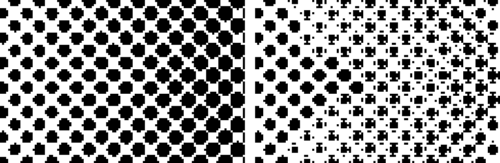
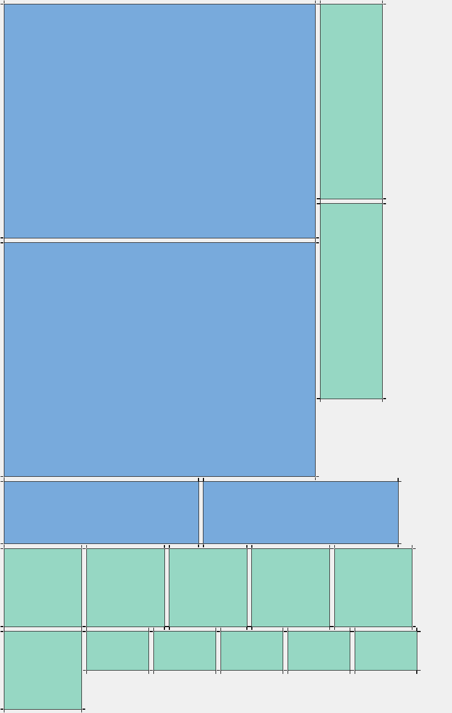

# Calibración de punto y calidad de sombras

## Ganancia de punto (☰ → Calibración de punto)
La tinta se expande sobre el film y el polvo agranda el borde, así que un tono nominal imprime más cobertura de la pedida (por ejemplo 30 % → 41 %).

1. Imprime `docs/CARTA-CALIBRACION.png` a 100 % con tu equipo, film y polvo, usando la lineatura que vas a producir (la ganancia aumenta con LPI altas).
2. Mide el porcentaje real de cada parche (10 … 90 %), con lupa o escáner y contando puntos.
3. Escribe pares `nominal:medido`, por ejemplo `10:14, 30:41, 50:63, 70:80, 90:94`. Hasta 10 pares; el medido debe crecer con el nominal y el último debe ser menor que 100.
4. El panel muestra qué se pedirá en realidad (`Para imprimir 10 / 30 / 50 / 70 / 90 % se pedirá 7 / 22 / 38 / 58 / 84 %`). Se aplica la curva inversa, interpolada linealmente entre puntos, después de los niveles y antes de comparar con la trama.
5. Se guarda con la receta (`gainPoints`). Mídela por equipo, film y lineatura.

## Rellenar huecos menores y «Sólido desde» (Ajustar → Detalles)
- **Rellenar huecos menores · mm:** en sombras casi sólidas los puntos casi se tocan y los poros que quedan se cierran al imprimir. Los poros de menos de ese diámetro equivalente se rellenan con el color del arte. Solo se rellenan píxeles que el cribado descartó: el color eliminado y las zonas transparentes del origen no se imprimen. 0 lo desactiva. Orden: tramado → limpieza de partículas → relleno de huecos.
- **Sólido desde cobertura · %:** cuando la cobertura ya compensada alcanza ese valor, el área se imprime sólida sin trama. 100 lo desactiva.

Referencia: 0,25 – 0,35 mm y 92 – 96 % son valores de partida razonables, no una calibración universal; prueba de lavado antes de producción.

## Límites
- La curva de ganancia es una aproximación lineal por tramos de tu medición.
- El relleno de huecos usa 4-conexión para los poros y 8-conexión para la tinta, igual que la limpieza de islas.
- La comprobación en Photoshop y el lavado físico siguen pendientes (`release-validation.json`).

## Presets de fábrica (Preparar → Preset)
Puntos de partida para trabajos comunes. Cada preset define forma, LPI, ángulo, niveles, color a eliminar, limpieza, poros y sólido; **no** cambia el tamaño, la curva de calibración, el color de prenda ni los costos de tinta. Tus recetas guardadas aparecen en el mismo selector («Receta · nombre»).

| Preset | Qué hace |
|---|---|
| Camiseta negra · foto | Quita el negro, 30 LPI a 33°, rellena poros de 0,25 mm y sólido desde 95 % |
| Camiseta negra · detalle fino | 40 LPI a 22,5°, limpieza baja; exige prueba de lavado |
| Camiseta blanca · logo y color | Quita el blanco, 35 LPI a 45°, niveles neutros |
| Vintage desgastado | 25 LPI a 45°, niveles que levantan el negro |
| Líneas · estilo grabado | Trama de líneas a 45° |
| Solo quitar fondo · sin trama | Elimina el color y deja el resto sólido |

## Estimación de tinta (☰ → Costos de tinta)
Muestra por pieza: ml de color y de blanca, porcentaje del área que cubre y, si el arte permite compararlo, cuánta tinta se ahorra frente a imprimir sin trama. Con precios por litro y por m² de film y polvo, añade el costo.

- **Consumo inicial:** color 8 ml/m² y blanca 12 ml/m² a cobertura total. Son valores aproximados: mide el tuyo con el contador de tinta de la impresora (ml usados ÷ m² impresos) y escríbelo.
- **Blanca:** se supone bajo cada píxel de color con la misma densidad.
- **«Menos tinta que sin trama»:** compara con imprimir sólido el arte cuya cobertura es de al menos 50 % después de quitar el color.
- **Lotes:** `reporte.csv` incluye `coveragePercent`, `colorML`, `whiteML` y `cost` por variante.
- La estimación no sustituye al contador de la impresora ni incluye purgas, limpiezas ni desperdicio de film.

## Canal blanco (Exportar → Exportar canal blanco)
Crea un segundo PNG con la tinta blanca del resultado, para RIP que aceptan un archivo de blanco aparte. El blanco sigue la forma del color y se **contrae** unos píxeles para que no asome por el borde cuando el film no registra perfecto.

- **Contracción (mm):** 0,15 mm por defecto (2 px a 300 ppp), de 0 a 5 mm. Se aplica con un elemento cuadrado (distancia de tablero de ajedrez), así que en bordes diagonales contrae algo más que en rectos.
- **Puntos pequeños:** la contracción de cada forma se limita a un 35 % de su semigrosor. Un punto conserva alrededor del 60–70 % de su diámetro y el centro de cualquier forma, por fina que sea, siempre queda. Con LPI altas el blanco puede quedar notablemente menor que el color: reduce la contracción si tu equipo registra bien.
- **El blanco nunca sale del color:** el archivo solo contiene píxeles que ya imprimen color.
- **Formato del archivo:** «Negro = tinta» (negro sobre fondo blanco), «Blanco sobre transparente» y «Blanco = tinta» (blanco sobre fondo negro). Cada RIP espera una polaridad distinta: confírmala con tu software antes de producir.
- Lee el resultado en Photoshop, comprueba que el alfa sigue siendo 0/255, y no modifica el documento. Hasta 128 MP.

La imagen sale del algoritmo real aplicado a una trama de 35 LPI; no es una captura de Photoshop.

## Pliegos (☰ → Armar pliego, o Exportar → Armar pliego con varios diseños)
Coloca varios PNG a 300 ppp en un rollo de ancho fijo y guarda el pliego, en vez de imprimir cada diseño por separado.

1. Elige los PNG (los que exportó el plugin; otros a 300 ppp también sirven) y las copias de cada uno.
2. Ancho de rollo: 30, 33, 42, 58, 60 cm u otro. Largo máximo opcional (0 = sin límite). Separación y margen en mm.
3. «Permitir girar 90°» ahorra film. «Marcas de corte» dibuja ocho trazos de 3 mm por diseño, fuera de sus esquinas (exige separación ≥ 6 mm y margen ≥ 5 mm). «Guardar también el canal blanco» crea el `_blanco.png` del pliego con los ajustes de contracción y formato de Exportar.
4. El panel muestra piezas, pliegos, medidas, aprovechamiento y m² de film (y su costo si indicaste el precio del film en Costos de tinta).
5. **Crear pliego y guardar PNG** pide una carpeta y escribe `pliego-01_58x74.2cm_300ppp.png` (y `_blanco.png`). Si el pliego superaría el largo máximo o 128 MP, se reparte en varios.

Cómo funciona: acomodo *skyline* de abajo hacia arriba sobre los diseños ordenados de mayor a menor; cada diseño se copia por bloques de 512 px, sin remuestrear ni mantener la imagen completa en memoria. Los diseños con otra resolución distinta de 300 ppp se omiten con un aviso.

Ejemplo con 17 piezas en un rollo de 58 cm: 75 % de aprovechamiento. Azul = girado 90°; los trazos negros son las marcas. Imagen generada por el algoritmo, no por Photoshop.

### Canal blanco en lotes (Lotes → Exportar también el canal blanco)
Marca la casilla en la pantalla de lotes y elige contracción y formato (se comparten con la pantalla Exportar). Por cada variante se guarda `NNN_imagen_M_front_300ppp.png` y `NNN_imagen_M_front_300ppp_blanco.png` en la carpeta de su talla.

- `reporte.csv` y el avance guardan la ruta del blanco (`whiteOutput`).
- Si el canal blanco de una variante falla, esa variante queda como error (`Canal blanco: …`) y se borran su PNG y su blanco; el resto del lote sigue.
- Al reanudar, se valida el PNG y también el blanco. Si falta o está dañado, la variante se rehace con un nombre nuevo (`_r2`).
- Cuesta tiempo y disco adicionales (lectura del color, contracción y un segundo documento por variante).

### Límites
- El acomodo es heurístico: no garantiza el mínimo de film posible. Sin marcas de corte, la separación es lo único que guía el corte.
- Los diseños se colocan en rectángulos (su caja completa); no se anidan formas irregulares.
- No hay botón de detener durante la creación de un pliego.
- Sin validar en Photoshop: `createDocument`, `app.open` y `putPixels` en documentos grandes quedan pendientes de la prueba nativa.
